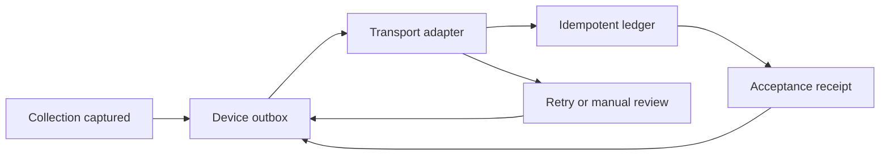

# Offline Collection Sync

**Mobile-finance synchronization reference: idempotency, bounded retries, and executable failure scenarios.**

An independent portfolio example using synthetic records. This is not employer code, a native mobile app, or a production payment service. Created with AI assistance.

## Problem

A field device submits a collection. The server accepts it, but the connection drops before the response arrives. Retrying must not record another payment. This example keeps the same identifier across retries, recognizes replays and rejects changed payloads using an existing key.

## Run

Node.js 22 or later; no dependencies, credentials or installation step.

```sh
node --test
node demo.js
```

Expected demo output:

```text
After lost response: pending
After retry: synced
Recorded payments: 1
```

## Architecture



| Component | Responsibility |
|---|---|
| Outbox | Pending collections, retry eligibility, receipt validation, failure isolation |
| Transport callback | Injected network boundary for deterministic failure testing |
| Ledger | Simulated server acceptance, duplicate detection and conflicting-key rejection |
| Validation | Explicit currency and positive safe integer minor-unit amounts |

## Implemented

- Defensive copies prevent accidental payload mutation.
- Idempotent acceptance handles repeated delivery without duplicate records.
- Exponential retry delay, capped at 60 seconds, with bounded attempts.
- Permanent errors and exhausted retries move to manual review.
- Invalid receipts never mark collections synchronized.
- One failed collection does not block later records.
- Concurrent sync calls on one outbox are rejected.
- Eleven automated tests, including lost responses and conflicting replays.

## Design boundaries

Storage is **in memory** and does not survive a restart. The transport has no built-in timeout: a real adapter must implement deadlines, cancellation, authentication and error classification. Currency validation checks format, not membership of an authoritative currency registry. No real payments are processed.

For Android, persist the outbox transactionally and schedule constrained background work. Hybrid/web clients need suitable durable storage. This JavaScript example illustrates the protocol; it does not implement Android APIs.

A production server needs database transactions, unique idempotency constraints, authorization-scoped keys, retention rules, audit trails and reconciliation. Add retry jitter, secure device storage, observability and cross-process coordination. The manual-review interface is outside this implementation.

## Code walkthrough

Start with `demo.js`, then `sync.js`, then `sync.test.js`. Discussion topics: ambiguous outcomes, at-least-once delivery, idempotency, device persistence, bounded retry and database-enforced uniqueness.
